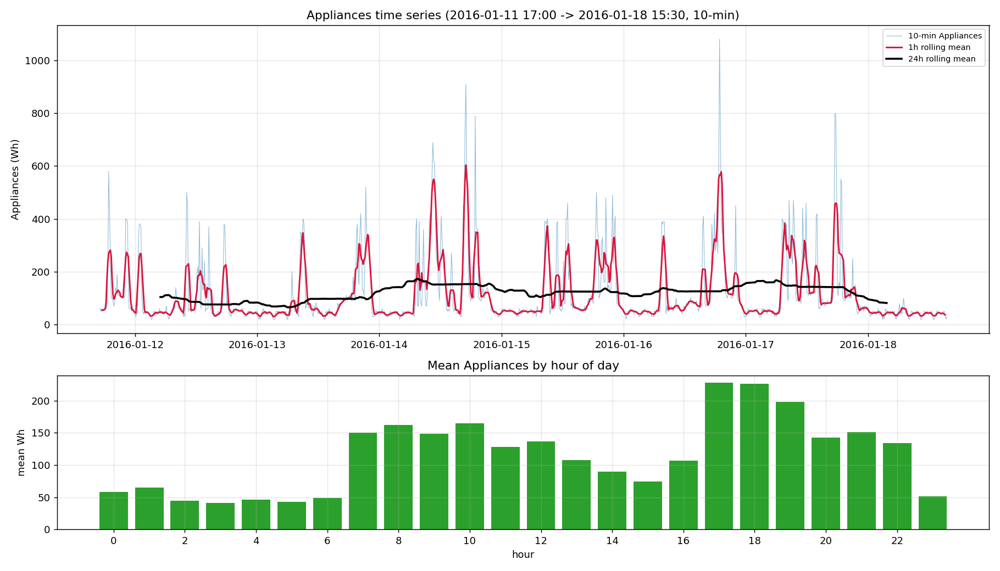

# Exploratory Data Analysis Report: A2_data_release.csv

> Target column: `Appliances` (appliance energy consumption, in Wh). This report only performs analysis and visualization, with no modeling.

## 1. Data overview

| Item | Result |
|---|---|
| Sampling interval | **10 minutes** (all 999 adjacent time differences are `0 days 00:10:00`, strictly evenly spaced) |
| Start time | **2016-01-11 17:00:00** |
| End time | **2016-01-18 15:30:00** |
| Time span | 6 days 22 hours 30 minutes (≈ 6.94 days) |
| Rows × columns | **1000 rows × 29 columns** |
| Missing values | **None** (all 28 numeric columns have 0 missing values) |

Column composition: 1 timestamp column `date` + 28 numeric features
- Target: `Appliances`
- Others: `lights`; 9 groups of indoor temperature/humidity `T1–T9` / `RH_1–RH_9`; outdoor `T_out`, `RH_out`, `Press_mm_hg`, `Windspeed`, `Visibility`, `Tdewpoint`; random variables `rv1`, `rv2`.

## 2. Statistics of each column

| Column | min | mean | max | std |
|:---|---:|---:|---:|---:|
| Appliances | 20 | 114.46 | 1080 | 131.388 |
| lights | 0 | 6.19 | 70 | 10.1137 |
| T1 | 18.39 | 20.8896 | 23.79 | 1.4007 |
| RH_1 | 32.0233 | 41.6689 | 55.8933 | 2.9115 |
| T2 | 17.7 | 20.0262 | 22.79 | 1.3598 |
| RH_2 | 30.16 | 40.5855 | 47.2233 | 2.5577 |
| T3 | 19.1333 | 20.5396 | 22.79 | 0.8173 |
| RH_3 | 35.03 | 42.6305 | 48.53 | 2.1667 |
| T4 | 18 | 19.7468 | 22.39 | 1.0037 |
| RH_4 | 35.5 | 42.0362 | 49.9475 | 2.6643 |
| T5 | 17 | 18.3768 | 21.9967 | 0.9909 |
| RH_5 | 41.5 | 55.2272 | 91.2933 | 8.5669 |
| T6 | -5.535 | 2.4559 | 7.9 | 3.1579 |
| RH_6 | 51.8233 | 88.4333 | 97.3 | 9.5441 |
| T7 | 17.1 | 18.6445 | 21.79 | 1.0029 |
| RH_7 | 30.736 | 39.6495 | 46.2633 | 3.2744 |
| T8 | 17.79 | 19.5871 | 22.76 | 1.149 |
| RH_8 | 37.2225 | 47.0823 | 55.09 | 3.5544 |
| T9 | 16.6 | 17.3295 | 18.5 | 0.4351 |
| RH_9 | 36.43 | 43.9324 | 50.4 | 3.2848 |
| T_out | -4.8 | 2.7117 | 7.5 | 2.8078 |
| Press_mm_hg | 733.5 | 754.631 | 765.6 | 8.6105 |
| RH_out | 59 | 86.2365 | 100 | 8.5934 |
| Windspeed | 1 | 4.969 | 11 | 2.3244 |
| Visibility | 14 | 35.148 | 65 | 9.2176 |
| Tdewpoint | -6.5 | 0.5323 | 5.3 | 2.9236 |
| rv1 | 0.0657 | 24.9846 | 49.9965 | 14.4194 |
| rv2 | 0.0657 | 24.9846 | 49.9965 | 14.4194 |

Key points: `Appliances` is highly volatile (std≈131, about 1.15× its mean; max 1080 far above the mean), clearly right-skewed/peaked; `rv1` and `rv2` have exactly identical values and are uninformative random/redundant columns.

## 3. Target series plot

The figure shows the 10-minute raw series (light blue) overlaid with a 1-hour rolling mean (red) and a 24-hour rolling mean (black), with a bar chart of the mean aggregated by hour of day below.

## 4. Intraday periodicity assessment

**Conclusion: there is a clear intraday cycle, dominated by two components of about 12 hours (semi-daily) and about 24 hours (daily).**

Basis:

1. **The autocorrelation (ACF) shows local peaks around about 1 day and its multiples**: lag=144 (24h)≈**0.128**, lag=288 (48h)≈**0.169**. Apart from the very-short-lag correlation (lag=1≈0.77), these daily-recurrence peaks are the most structured periodic signals in the series.
   > Note: measured ACF at lag=432 (72h) is only ≈0.089 and does not form a peak, so the claim that "peaks fall strictly at integer multiples of 24h" does not hold; limited by only about 7 days of data, higher-order autocorrelation is itself unstable. The only truly stable peaks are at 24h and 48h.

2. **The spectral (periodogram) main peak corresponds to about 12 hours and the secondary peak to about 24 hours**: the maximum power peak period is ≈ **11.9 h** (power ≈ 7.65×10⁸), followed by ≈ **23.8 h** (power ≈ 5.77×10⁸), exhibiting a typical day-night structure dominated by the semi-daily harmonic with the daily period as a secondary component.

3. **The mean aggregated by hour shows a clear day-night pattern**: lowest in the early hours 0–6 and at 23 (mean ≈ 41–65 Wh), with peaks in the morning and evening — 7–10 a.m. ≈ 149–165 Wh, and a peak in the evening 17–19 ≈ 198–228 Wh. The standard deviation of the hourly means is about 0.45 of the overall standard deviation, indicating stable systematic intraday variation.

Combining the three lines of evidence, `Appliances` has a significant intraday cycle: in the spectrum the semi-daily (≈11.9h) component is strongest and the daily (≈23.8h) component second; the autocorrelation shows local peaks at 24h/48h; and the hourly-aggregated means show a stable daily day-night pattern (peak in the evening 17–18, trough in the early hours 3–4).
