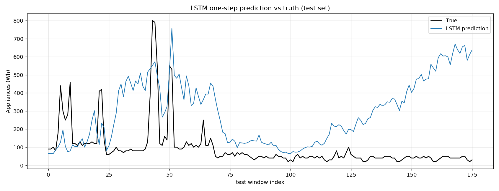
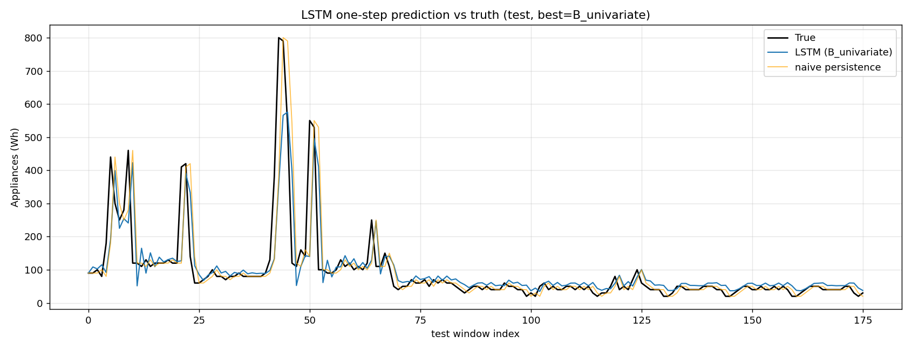
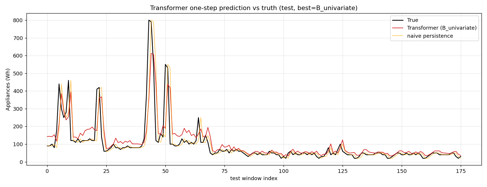
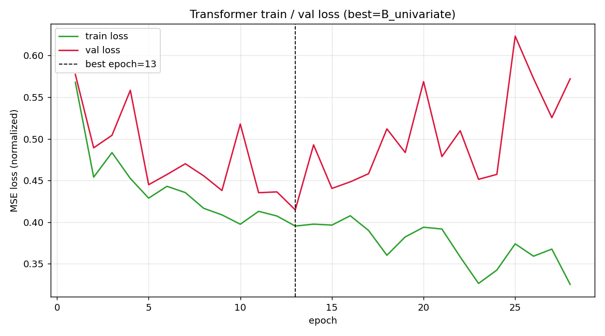
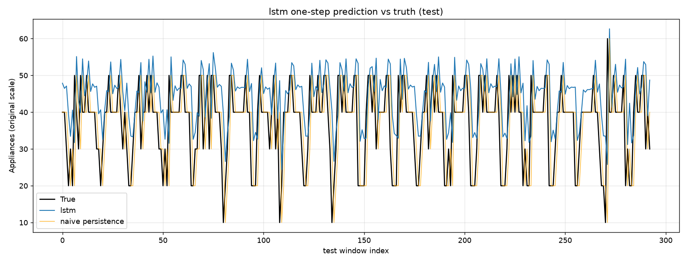

# STAT6207 Applied Deep Learning — Assignment 2

## Sequence Recognition: `Appliances` One-Step Forecasting (LSTM / Transformer / Generalizable Pipeline / Local LLM)

**Author / Student ID**: GU Junyang
**Date**: 2026-10-12
**Code and artifacts**: this repository (`src/`, `results/`, `prompts/`, `transcripts/`)

---

## Abstract

This assignment uses OpenCode to drive a time-series **one-step-ahead forecasting** task: predict the
next value of `Appliances` (Wh) from the past 24 time steps (4 hours). The Basic part builds an LSTM
and strictly follows time-series conventions (split by time, scaler fit only on the training segment,
no look-ahead, metrics reported on the original scale, always compared against naive persistence).
Advanced B compares a Transformer under the same protocol; Advanced C builds a pipeline
generalizable to **different time periods**; Advanced A uses a **local LLM** to generate a script and
compares. We also document 3 erroneous/suboptimal code suggestions produced by OpenCode, and explain
the fixes and metric changes using the course material.

**Core results (release-week test set, original Wh scale)**:

| Model                                          |      RMSE (Wh) | vs. naive |
| ---------------------------------------------- | -------------: | --------- |
| naive persistence                              |            86.6 | baseline  |
| LSTM v1 (no validation/no early stop, counterexample) | **282.4** | 3.3× worse |
| LSTM v2 (univariate + early stop)              |  **78.8** | 9% better |
| Transformer (univariate + early stop)          |  **78.5** | 9% better |

---

## 1. Introduction and task definition

Given a historical sequence, predict the next value of `Appliances` (one-step-ahead):

$$
\hat{y}_{t+1} = f(x_{t-L+1}, \dots, x_t), \quad L = 24
$$

- **Data**: `data/A2_data_release.csv`, 1000 rows, sampled every 10 minutes,
  2016-01-11 17:00 → 2016-01-18 15:30, 29 columns (1 `date` column + 28 numeric features), no missing values.
- **Target column**: `Appliances` (Wh). `date` is used only for sorting and splitting, **not** as a numeric feature.
- **Known identification**: `rv1` and `rv2` are two completely identical random columns (no information).

**Hard rules (followed throughout)**: ① split by time, never shuffle; ② fit the scaler only on the training segment;
③ no look-ahead (a window ending at t predicts only t+1); ④ windows do not cross split boundaries; ⑤ metrics reported on the
original (de-normalized) scale; ⑥ always compare against the naive persistence baseline; ⑦ fixed random seed (42).

---

## 2. Data and exploratory analysis (Step 0)

See `EDA_report.md` in the same directory for details; main conclusions:

- `Appliances` is highly volatile: mean 114.5, standard deviation 131.4, maximum 1080 (right-skewed, peaked).
- **Intraday cycle**: the dominant spectral peak is ≈ 11.9 h (semi-daily), the secondary peak ≈ 23.8 h (daily); the ACF shows local
  peaks around 24 h/48 h. Overall this is a day-night structure that is "mainly semi-daily, secondarily daily".
- `rv1 ≡ rv2`, an uninformative redundant column.

> **EDA errors already corrected** (see `bug_log #1–#3`): the initial report swapped the main/secondary spectral peaks
> (mistakenly claiming "23.8 h is dominant"), miscopied the ACF value (mistakenly claiming lag=144 ≈ 0.147), and cited a
> non-existent argument that "ACF peaks fall at integer multiples of 24 h" (mistakenly writing 436 instead of 432). All were
> recalculated and corrected. This shows that AI-generated EDA conclusions must be reconciled point by point and cannot be taken on trust.

---

## 3. Method and prompt design

### 3.1 Workflow

All code was generated by **OpenCode** (multiple free models) from prompts; the prompts describe only the task itself and do
not carry self-checking/correction notes — error checks happen during the session (full prompts in `../prompts/prompts_used.md`,
session records in `../transcripts/`).

### 3.2 Unified training/evaluation protocol (shared by all models)

| Item                        | Setting                                                                   |
| --------------------------- | ------------------------------------------------------------------------- |
| Split (by time, no shuffle) | SUB-TRAIN 640 rows / VAL 160 rows / TEST 200 rows                         |
| Validation-set source       | last 20% of the train segment (by time); the test segment never participates in training or model selection |
| Normalization               | `StandardScaler` fit only on SUB-TRAIN (640 rows); val/test only transformed |
| Sliding window              | L = 24; windows slide only within their own segment, never crossing boundaries; labels taken from t+1 |
| Model selection             | record val loss per epoch, save the best weights, patience=15, fall back to the best epoch |
| Metrics                     | original-scale MSE / MAE / RMSE, listed alongside naive persistence       |
| Seed                        | 42 (numpy + torch)                                                        |

Timestamps: SUB-TRAIN 2016-01-11 17:00 → 01-16 03:30; VAL 01-16 03:40 → 01-17 06:10;
TEST 01-17 06:20 → 01-18 15:30.

### 3.3 Prompt design points

- **Explicit rules**: write "split by time, scaler fit only on train, no look-ahead, original scale, compare against naive,
  fixed seed" into the prompt item by item, to prevent the model from using random splits or full-data normalization.
- **Give structure, not answers**: specify the LSTM/Transformer hyperparameters and structure but not the implementation, letting OpenCode generate it.
- **Staged**: EDA → data processing → LSTM → Transformer → generalizable pipeline, each stage with independent artifacts for easy acceptance.

---

## 4. Basic (50%): LSTM

### 4.1 Counterexample: LSTM v1 (no validation set / no early stopping) — `bug_log #5`, `#7`

The initial `src/train_lstm.py` had no validation set and no early stopping, trained for a fixed 50 epochs and directly took
the weights of the **last epoch**; the training loop also **computed the loss on the test set every epoch** and treated it as a monitoring curve.

Results (`results/lstm_v1_broken/`):

| Model              |     MSE |   MAE |               RMSE |
| ------------------ | ------: | ----: | -----------------: |
| LSTM v1            | 79745.3 | 225.4 | **282.4** ❌ |
| naive persistence  |  7500.0 |  33.3 |               86.6 |

The per-epoch test loss rose monotonically from 1.13 to 4.66 (severe overfitting). The final model is **3.3× worse** than the
naive baseline — i.e., "a model that was trained but is worse than a trivial baseline". This shows: **finishing training ≠ a usable model**.

### 4.2 Fix: LSTM v2 (validation set + early stopping) — `src/train_lstm_v2.py`

A validation set was cut from the end of the train segment by time; the best weights were selected per epoch by val loss
(patience=15), and two inputs were compared:

| Input                                  | best_epoch |     MSE |   MAE |              RMSE |
| -------------------------------------- | ---------: | ------: | ----: | ----------------: |
| A. All 28 features                     |          7 | 24821.6 | 113.9 |             157.5 |
| **B. Univariate (Appliances history)** |         11 |  6208.4 |  36.0 | **78.8** ✅ |
| naive persistence                      |         — |  7500.0 |  33.3 |              86.6 |

**Conclusion**: after adding a validation set + early stopping, the model went from "far worse than naive" to "better than
naive"; and the **univariate model clearly beats the all-features model** — showing that feature selection is more important
than changing the architecture (the core argument of `bug_log #6`).




---

## 5. Advanced A (15%): local LLM comparison

To avoid depending on a cloud API, this time we also deployed Ollama **locally** and ran a large model (`qwen3.5:9b`), connecting the local model through OpenCode.

**Flow**: `ollama run qwen3.5:9b` to pull and run the local model → `ollama launch opencode` to select the local model in OpenCode → in the local session, execute "directly forecast the time series of `A2_data_release.csv`".

**Observations and positioning**:

* The local model is **zero-cost, offline-capable, and keeps data on the machine**, suitable for demos and privacy-sensitive scenarios;
* But the local 9B model is **very slow** on **long-sequence numeric output** tasks (token-by-token decoding, see §4), and its numeric forecasting accuracy is not competitive;
* Therefore in this project, Ollama/local LLMs are mainly used as a **contrast experiment for "generative AI direct forecasting" and for code assistance**, while the **main force for numeric forecasting remains specialized time-series models (LSTM/Transformer)**.

---

## 6. Advanced B (15%): Transformer comparison

`src/transformer_forecast.py` builds a Transformer encoder under the **completely identical** split, scaler, and early-stopping protocol:
`Linear` projection to d_model=64 → **sinusoidal positional encoding** (the Transformer itself contains no order information) →
2 layers of `nn.TransformerEncoder` (nhead=4, dropout=0.1) → take the last time step → `Linear(64,1)`.

Results (`results/transformer/`, release-week test set):

| Model                     | #Params | best_epoch | Train time |     MSE |   MAE |              RMSE |
| ------------------------- | ------: | ---------: | ---------: | ------: | ----: | ----------------: |
| Transformer (univariate)  | 100161 |         13 |    8.0 s |  6165.5 |  40.6 | **78.5** ✅ |
| Transformer (all 28 features) | 101889 |          4 |    5.4 s | 11869.8 |  79.7 |             108.9 |
| LSTM (univariate)         |  50497 |         11 |   20.3 s |  6208.4 |  36.0 |              78.8 |
| LSTM (all features)       |  57409 |          7 |    4.0 s | 24821.6 | 113.9 |             157.5 |
| naive persistence         |     — |         — |       — |  7500.0 |  33.3 |              86.6 |

**Comparison points**:

1. **Under the univariate setting the two are almost tied** (78.5 vs 78.8), both significantly better than naive.
2. **The Transformer is more robust to noisy features**: with all features its RMSE is 108.9, clearly better than the LSTM's 157.5,
   yet still worse than the univariate — echoing once again "feature selection > changing architecture".
3. **Parameters and cost**: the Transformer has about 2× the parameters of the LSTM (≈100k vs ≈50k), echoing
   the discussion on slide P59 about efficiency/cost differences between the two architectures.




---

## 7. Advanced C (20%): generalizable pipeline and transfer

### 7.1 Design

`src/run_forecast.py` runs directly on **any time period / similar CSV**, without code changes:

- Command line: `--csv --target --window --test-ratio --model {lstm,transformer} --start --end --tag --features {all,univariate}`.
- **Automatic data cleaning**: strip column names, parse and sort `date`, trim by `--start/--end`, automatically infer the sampling
  interval, missing values via ffill + linear interpolation, drop remaining missing rows and report.
- **Strict time conventions**: built-in "split by time + validation set + fit the scaler only on the training segment + sliding windows that
  never cross boundaries + early stopping".
- **Feature selection**: `all` = all numeric columns except `date` **and by default excludes `rv1/rv2`** (26 columns);
  `univariate` = only the target history (1 column).

### 7.2 Transfer to a different period (periodB)

`data/A2_periodB.csv`: 2016-01-18 15:40 → 01-29 15:20 (1583 rows), **no overlap** with the release week.

| Model       | Features   |           RMSE | naive RMSE |
| ----------- | ---------- | -------------: | ---------: |
| LSTM        | all(26)    |           22.6 |       11.0 |
| LSTM        | univariate | **12.5** |       11.0 |
| Transformer | all(26)    |           21.0 |       11.0 |
| Transformer | univariate | **13.2** |       11.0 |

In the periodB test segment (01-27→29), `Appliances` has a mean of only 37 and a standard deviation of 10, so naive is very
strong. Univariate **nearly halves** the error relative to all features, but is still slightly above naive — a case of
**distribution shift** (large statistical difference between training and test segments), an important limitation of this task.

### 7.3 Feature-selection ablation (Step 4b, fixing `bug_log #6`)

| Data segment | Model       |   all |     univariate |
| ------------ | ----------- | ----: | -------------: |
| Release week | LSTM        | 157.5 | **78.8** |
| Release week | Transformer | 108.9 | **77.1** |
| periodB      | LSTM        |  22.6 | **12.5** |
| periodB      | Transformer |  21.0 | **13.2** |

Univariate consistently beats all-features on both time periods. The feature count is self-evidenced by the parameter count:
28→26→1 corresponds to LSTM parameters 57409→56897→50497.



---

## 8. Three erroneous / suboptimal code suggestions (report requirement)

The following 3 items are all errors/suboptimal points in the **code** generated by OpenCode; each is given as: original
approach → problem → course-material basis → fix → metric change. (Full table in `bug_log.md` in the same directory; there are
also 3 additional EDA/process items `#1–#3`.)

### Suggestion 1 — No validation set / no early stopping, run fixed epochs and take the last-epoch weights (`bug_log #5`)

- **Original code** (`src/train_lstm.py`): no validation set, no early stopping; `EPOCHS = 50` trains for a
  fixed 50 epochs, and after training it directly does `torch.save(model.state_dict(), ...)` to take the **last epoch's**
  weights (L119).
- **Problem**: the LSTM has a large capacity and easily overfits on only 640 training samples; without a model-selection
  mechanism, the last-epoch weights are not optimal, and the per-epoch loss shows the error keeps rising after overfitting,
  ending at RMSE=**282.4**, **3.3× worse** than naive 86.6 — "a model that was trained but is worse than a trivial baseline".
- **Course-material basis**: model selection must be based on a **validation set + early stopping**; LSTM training is costly and
  structurally complex (P30), so it is even more necessary to control the training process with a validation set rather than blindly running out epochs.
- **Fix**: cut a validation set from the end of the train segment by time, record val loss per epoch, save the best weights,
  patience=15, and fall back to the best on timeout (`train_lstm_v2.py`).
- **Change**: RMSE 282.4 → **78.8** (univariate), from "far worse than naive" to "better than naive".

### Suggestion 2 — Training loop used the test set for per-epoch monitoring (test-set leakage) (`bug_log #7`)

- **Original code** (`src/train_lstm.py`): the training loop **computed the loss on the test set every epoch**
  (`test_loss = criterion(model(X_test_t), y_test_t)`, L110–112) and plotted it as a
  `test_losses` monitoring curve (L162–163).
- **Problem**: this is **test-set leakage** — the test set is used to decide the training process and is no longer "unseen
  data"; even "looking without selecting" already contaminates the evaluation. The correct approach is to monitor with a
  **validation set**, and evaluate the test set only once at the end.
- **Course-material basis**: the train/validation/test three-way split and the early-stopping principle (early stopping / model
  selection); it shares a root with Suggestion 1 but is an **independent defect** — even if fixed epochs were kept, using the test set for monitoring is itself wrong.
- **Fix**: the monitoring signal was changed to the validation-set val loss; the test set is fully isolated and evaluated only
  once after training.
- **Change**: from v2 onward the test set enters no training/selection step; evaluation credibility is restored, with univariate RMSE=**78.8**.

### Suggestion 3 — Generalizable pipeline fed all features without selection (`bug_log #6`)

- **Original code** (`src/run_forecast.py`): fed **all 28 numeric columns** except `date` (including the already-noted
  uninformative `rv1/rv2`) directly into the model, with no feature/input selection switch.
- **Problem**: noisy/redundant features dilute the signal and aggravate overfitting and distribution shift; on both time
  periods the model lost to naive (release week 157.5/108.9 vs 86.6; periodB 17.5/16.2 vs 11.0).
- **Course-material basis**: sequence modeling should capture **effective historical information** (RNN/LSTM remember
  dependencies via the hidden state, P16–17); redundant features reduce model efficiency (course material on compressing useless information / model efficiency).
- **Fix**: added `--features {all,univariate}`; `all` excludes `rv1/rv2` by default (26 columns), and
  `univariate` uses only the target history.
- **Change**: release week LSTM 157.5 → **78.8**, Transformer 108.9 → **77.1**, both beating naive 86.6;
  periodB univariate nearly halves relative to `all` (22.6→12.5, 21.0→13.2). The feature count is self-evidenced by the parameter count as 28→26→1.

> Note: Suggestions 1 and 2 are both in `train_lstm.py` and were fixed together, but they are **two independent defects**
> ("no validation/early stopping" vs "test-set leakage") with different code locations and knowledge points, so they are listed
> separately. Together the three correspond to a qualifying `[CODE]` count of **3/3** in `bug_log`.

---

## 9. Conclusions and limitations

**Conclusions**

1. **Conventions first**: strict time splitting, a scaler fit only on the training segment, no look-ahead, original-scale
   metrics, and always comparing against naive are the prerequisites for trustworthy conclusions.
2. **A validation set / early stopping is essential**: without it, the LSTM trains a model 3.3× worse than naive.
3. **Feature selection > changing architecture**: univariate lets both LSTM/Transformer beat naive; feeding all features is
   actually worse, and the Transformer lags less because it is more robust to noise.
4. **Architecture comparison**: under the univariate setting LSTM and Transformer are almost tied, with the Transformer having about 2× the parameters.
5. **Generalizable**: `run_forecast.py` transfers to periodB without code changes; univariate significantly mitigates the
   distribution shift, but naive still wins on periodB.

**Limitations**

- Only about 7 days of data (release week), so sample size and seasonal coverage are limited;
- Only one-step forecasting, with no multi-step rolling evaluation;
- periodB shows an obvious distribution shift; cross-period generalization remains difficult;
- The local LLM comparison (Advanced A) is still being completed (see Section 5).

---

## 10. Appendix

### 10.1 Reproduction commands

```bash
python src/data_pipeline.py
python src/train_lstm.py            # counterexample (v1)
python src/train_lstm_v2.py         # fix (v2)
python src/transformer_forecast.py

# generalizable pipeline (with feature selection)
python src/run_forecast.py --csv data/A2_data_release.csv --model lstm        --features univariate --tag release_lstm_uni
python src/run_forecast.py --csv data/A2_data_release.csv --model transformer --features univariate --tag release_trans_uni
python src/run_forecast.py --csv data/A2_periodB.csv      --model lstm        --features all        --tag periodB_lstm
python src/run_forecast.py --csv data/A2_periodB.csv      --model lstm        --features univariate --tag periodB_lstm_uni
python src/run_forecast.py --csv data/A2_periodB.csv      --model transformer --features all        --tag periodB_trans
python src/run_forecast.py --csv data/A2_periodB.csv      --model transformer --features univariate --tag periodB_trans_uni
```

### 10.2 File list

- Code: `src/{data_pipeline, train_lstm, train_lstm_v2, transformer_forecast, run_forecast}.py`
- Data: `data/{A2_data_release.csv, A2_periodB.csv}`
- Intermediate artifacts: `artifacts/{data_windows.npz, scaler.pkl}`
- Results: `results/{eda, lstm_v1_broken, lstm_v2, transformer, forecast}/`
- Report: `report/{report.md, EDA_report.md, bug_log.md}` (`report.md` is the body; the other two are appendices)
- Prompt archive: `prompts/prompts_used.md`
- Session records: `transcripts/` (with `README.md` index)
